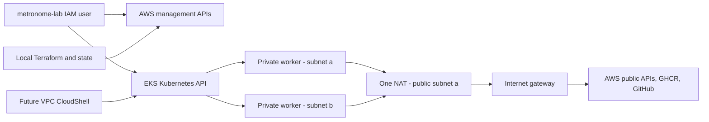

# EKS foundation: architecture and teaching walkthrough

Status: prepared locally on October 19, 2026; **not applied**. The user requested
implementation first, followed by explanations in small steps. This document
is the reference for those lessons, not a claim that every topic has been taught.
Commands and lifecycle gates are in the [Terraform README](../infra/aws/lab/README.md).

## Platform before application

AWS runs the EKS control plane. We supply EC2 workers for Pods. The two private
subnets are placement options for one node group; they do not guarantee that
every application has replicas in different AZs. Applications will need their
own replicas, scheduling constraints, probes and persistence design.

The eventual browser path remains DNS -> public HTTPS ALB -> Nginx -> internal
APIs, with Cognito on operator routes. **None of those application entry
components is created by this foundation.** NAT handles outbound connections;
it is not on the inbound browser path.

## Walkthrough order

### 1. Managed node group: the missing machines

`workers.tf` previously described how a worker should be launched. The new
`aws_eks_node_group.workers` requests the actual worker fleet: two on-demand
`t3.medium` instances in the private subnets, running a pinned EKS-optimized
Amazon Linux 2023 release.

The launch template supplies security groups, root storage and metadata
settings; the node group supplies cluster membership, IAM role, subnets, image
family and capacity. We reference a numeric template version so a reviewed
template change can trigger a managed rollout. No manual node bootstrap script
or IAM instance profile is inserted into the template.

The root disk stores the OS, downloaded images and node-local runtime files.
Each worker has 30 GiB encrypted gp3; termination deletes that root disk.
It is not the future runner's persistent data volume. T3 standard credit mode
trades sustained CPU speed for avoiding unlimited surplus-credit charges.

AWS replaces unhealthy EC2 instances through the managed fleet, but this alone
does not repair application state or guarantee uninterrupted service. Node
updates allow one unavailable worker; default updates may temporarily launch
extra workers. See [managed node updates](https://docs.aws.amazon.com/eks/latest/userguide/managed-node-update-behavior.html).

Understanding check: which block says **how to launch one machine**, and which
block requests **how many machines**?

### 2. Add-ons: making the workers a usable Kubernetes cluster

`addons.tf` manages four platform components:

| Component | Purpose | Typical failure symptom |
| --- | --- | --- |
| VPC CNI (`aws-node`) | Assigns Pod IPs and manages node interfaces/IP pools | Pods cannot obtain networking; workers can remain NotReady |
| kube-proxy | Implements Service traffic forwarding on nodes | Service IPs fail while direct Pod connections may work |
| CoreDNS | Resolves in-cluster Service names | DNS names fail while connections to known IPs may work |
| Pod Identity Agent | Supplies a workload's AWS identity through the EKS Auth service | AWS calls fail for associated workloads |

Self-managed bootstrap add-ons are disabled so Terraform owns these managed
add-ons from creation. CNI, kube-proxy and the agent are requested before the
node group; CoreDNS follows workers because its Deployment needs compute to
become healthy. Live bootstrap ordering still needs integration verification.
Version pins and the AMI ID/release are collected in `versions.tf`; provider
locking alone does not lock these separate artifacts.

CNI network-policy support is enabled in **standard startup mode**. No app
isolation policies are installed. Standard mode permits traffic before policy
programming completes; strict mode needs deliberate platform/DNS policies.
NetworkPolicy cannot authorize AWS API actions. See [AWS policy setup](https://docs.aws.amazon.com/eks/latest/userguide/cni-network-policy-configure.html).

Understanding check: if a Pod can contact an IP but cannot resolve a Service
name, which add-on would you inspect first?

### 3. Pod Identity: permissions belong to the networking workload

The EC2 worker role still handles node-level AWS operations and EKS system
image pulls. The CNI's interface-management permission is attached to a separate
`metronome-lab-vpc-cni` role, not the worker role.

The CNI add-on owns the Pod Identity association for `kube-system/aws-node`.
Its trust policy accepts `pods.eks.amazonaws.com` with session tags matching
the exact cluster ARN, namespace and service account. This is different from
the human EKS access entry and Kubernetes RBAC. Do not disable session tags
without revisiting the trust conditions. See [Pod Identity trust](https://docs.aws.amazon.com/eks/latest/userguide/pod-id-role.html)
and [session tags](https://docs.aws.amazon.com/eks/latest/userguide/pod-id-abac.html).

Normal application Pods are not assigned an AWS role here. Required IMDSv2 and
hop limit 1 reduce their ability to use the node's metadata credentials;
host-networked components can still reach IMDS. The agent and CNI use host
networking, so their bootstrap does not depend on ordinary Pod networking.
AWS service calls use the existing NAT/HTTPS path; this is not an endpoint-only
private cluster. See [EKS networking requirements](https://docs.aws.amazon.com/eks/latest/userguide/network-reqs.html).

Understanding check: would creating a Kubernetes RoleBinding grant a Pod
permission to create an EC2 network interface?

### 4. Network and security boundaries

The new DNS rules permit control-plane connections to worker DNS on TCP/UDP 53.
CloudShell HTTPS egress permits AWS API calls/downloads through NAT. Existing
worker self-access and external HTTPS remain broad baseline choices. The
destination-restricted egress follow-up remains **NET-EGRESS-01**.

EKS also creates its own cluster security group. Custom groups on the control
plane are additive, not replacements for its defaults. The worker launch
template explicitly supplies our worker group, so EKS does not also attach its
default cluster group to those workers. Review effective groups rather than
assuming our custom control-plane egress list is an exclusive allowlist.
See [EKS security groups](https://docs.aws.amazon.com/eks/latest/userguide/sec-group-reqs.html)
and [launch templates](https://docs.aws.amazon.com/eks/latest/userguide/launch-templates.html).

Kubernetes Service addresses use `172.20.0.0/16`, distinct from the VPC's
`10.30.0.0/16`. A Service address is a virtual destination implemented by the
cluster, not a subnet allocated to EC2 instances.

One NAT is deliberately inexpensive relative to one per AZ, but creates an
AZ-a egress dependency and potential cross-AZ transfer. A NAT failure can break
image pulls and AWS API calls even while some existing internal traffic works.

### 5. Observation and lifecycle

`logging.tf` adds an EKS log group before the cluster so retention is controlled
from creation. API, audit and authenticator logs help distinguish authentication
failures from Kubernetes authorization failures. VPC Flow Logs describe network
traffic metadata, not HTTP contents or operator identity. Both groups cost
money according to usage and are deleted during intentional foundation teardown.

`outputs.tf` exposes non-secret IDs for verification/CloudShell setup. These
outputs identify resources; they neither grant permissions nor create routes.
`main.tf` adds ownership tags and rejects an unreviewed Region. Local state
still needs backups and protection; a remote state backend is a later choice.

`infra/aws/tools/aws-lab.mjs` supplies read-only checks, future read-only cluster
verification, and guarded foundation teardown. It will refuse the full app's
resources until cleanup is extended and reviewed. Mocked deletion tests are
not proof that AWS will successfully clean up real dependencies.

## Current IAM access review: CNI role

This review explains the selected AWS-managed CNI policy; it does **not** claim
that the policy is a custom minimum. Its broad modification scope remains a
pre-apply review item. AWS can revise a managed policy independently of our
provider/version pins.

| Policy action (`ec2:` prefix) | Why the CNI needs it |
| --- | --- |
| AssignPrivateIpAddresses | Allocate Pod IPs |
| UnassignPrivateIpAddresses | Return unused IPs |
| CreateNetworkInterface | Expand networking capacity |
| AttachNetworkInterface | Connect interfaces to workers |
| DetachNetworkInterface | Release worker attachments |
| DeleteNetworkInterface | Remove unused interfaces |
| ModifyNetworkInterfaceAttribute | Configure interface behavior |
| DescribeInstances | Inspect worker networking |
| DescribeInstanceTypes | Discover networking capacity |
| DescribeNetworkInterfaces | Inspect IP allocation |
| DescribeSubnets | Select eligible subnet capacity |
| DescribeSecurityGroups | Inspect interface security |
| DescribeTags | Discover resource metadata |
| CreateTags | Identify managed interfaces |

The first statement uses `Resource: "*"`; interface tagging uses an ENI ARN
pattern across Regions/accounts. Describe actions commonly require wildcard
resources, while modification/tag scopes deserve further restriction testing.
Do not interpret a scoped trust policy as scoped EC2 permissions.
[Policy source, default version v6 at review](https://docs.aws.amazon.com/aws-managed-policy/latest/reference/AmazonEKS_CNI_Policy.html).

Before deployment, review this and the existing cluster/worker managed policies.
Narrow modifications using verified EC2 action/resource/condition support and
test them against bootstrap/recovery, rather than guessing conditions that
silently stop IP allocation. Human AdministratorAccess is a separate documented
account-bootstrap decision in [the human access record](aws-human-access.md).
