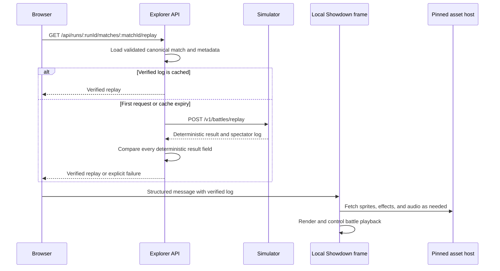

# Verified battle replays

In the online report, expand **Battle explorer**, select a battle, and click
**Watch replay**. The permanent interface is an in-page dialog. It starts paused
and muted, with play/pause, reset, previous/next turn, turn selection, speed,
switch-side, and sound controls. Escape closes it, including from inside the
player. The downloadable offline report remains self-contained.

## Run locally

Use Node 24.20.0. Install simulator and frontend dependencies with
`npm ci --ignore-scripts` in their respective directories. From the repository
root, start each service in its own terminal:

```powershell
node scripts/serve-replay-assets.mjs
```

```sh
node simulator/src/server.js
```

```sh
TOURNAMENT_STATE_ROOT="$PWD/evidence/tournaments" \
SIMULATOR_BASE_URL=http://127.0.0.1:3000 node explorer-api/src/server.js
```

```sh
npm --prefix explorer-web run dev
```

Open `http://localhost:5173/runs/sample-32-002`. Frontend development proxies
`/api` to port 3001; the API delegates replay generation to port 3000. The archive
root must contain a `runs` directory. For a different archive, use an absolute
`TOURNAMENT_STATE_ROOT`. The read-only asset server exposes the ignored pinned
snapshot from `.local-assets/showdown/c0f6bfc-2026-10-05` at
`http://127.0.0.1:4174/c0f6bfc-2026-10-05/`; it does not copy those files into
the frontend build or cluster. All canonical artifacts remain read-only.

## Regenerate, verify, display



Supported rules are `metronome-singles-v1`, with `pokemon-showdown@0.11.11` and
the existing 100-turn cap, teams, seed, and choices. Normal simulations do not
capture logs. The original raw protocol hash still excludes timestamp lines;
spectator extraction is a separate operation and never changes that hash.

Verification includes match identity, participants, seed, engine version, winner,
outcome, turns, termination, and protocol hash. Hostname and wall-clock duration
are operational observations and are not compared. Mismatches return
`409 REPLAY_MISMATCH` with no playable log; unsupported versions return
`422 REPLAY_UNSUPPORTED`. Temporary failure, busy, and timeout responses offer a
retry. Logs are never uploaded to the public Showdown replay service.

Each API process has a five-minute LRU cache, capped at 100 entries and 16 MiB.
Its key fingerprints current canonical inputs and expected results. Identical
pending requests share work; at most two different generations run concurrently
per API process. Generation times out after 30 seconds and logs are capped at
1 MiB. Only verified successes enter the cache. Closing a pending dialog aborts
the browser request; shared server-side regeneration can finish and populate the
cache. No database or writable replay volume is needed.

Structured logs identify cache hits, generation duration, mismatching fields,
and upstream failures, without printing battle protocols.

## Pinned viewer and assets

The frontend vendors the battle/replay subset at client commit
`c0f6bfc707a5e3bba4da3785e9cb06c8ae04f8d9`. Simulator data and the MIT formatter
are frozen from `pokemon-showdown@0.11.11`; sprite dimensions are a separately
hashed snapshot from the asset host. `vendor/showdown/manifest.json` records
every source checksum. `npm run build:showdown` verifies inputs and rebuilds the
isolated classic-script engine; frontend development and production builds run
it automatically without network downloads. The data adapter converts the old
simulator's text placeholders to the pinned client's syntax without modifying
battle inputs or logs.

JavaScript, supporting data, and styles are packaged with the frontend. Graphics,
sprites, effects, and audio are fetched from the pinned snapshot only when the
browser needs them. The dashboard also uses that snapshot's Gen 5 sprites beside
Pokémon names. `/runtime-config.js` supplies the snapshot directory URL. Local
configuration permits HTTP only on loopback; non-loopback asset hosts must use
HTTPS. URLs with credentials, a query, or a fragment are rejected. Preserve the
snapshot's `sprites/`, `fx/`, and `audio/` paths.

The runtime file is deliberately outside the hashed application bundle. The same
tested web image can therefore be promoted unchanged: the local ConfigMap points
at `http://127.0.0.1:4174/c0f6bfc-2026-10-05/`, while the prepared Azure ConfigMap
points at the versioned Azure Blob directory. Do not add the snapshot or its URL
as a Docker build argument.

The frame accepts structured messages only from its application-origin parent with
the matching replay identity. Its sandbox gives it an opaque origin and prevents
access to the parent's DOM and storage. The parent checks the frame window, opaque
origin, and replay identity before accepting messages; messages sent to that frame
use `*` because opaque origins cannot be named as a target origin. It cannot submit forms, navigate the parent, or load
remote executable scripts. Only `/showdown/player.html` permits same-origin
framing through CSP `frame-ancestors 'self'`; the rest of the production frontend
retains `X-Frame-Options: DENY`. The player uses an HTTP CSP sandbox (also supplied
by the development server), so scripts cannot remove it by changing the iframe's
attributes. Only the packaged viewer styles permit CORS for the opaque frame's
stylesheet fetches. The player response omits the redundant `X-Frame-Options` header.
Missing player assets show an error or warning with a readable verified log.

Missing or invalid `showdownAssetBaseUrl` also shows an actionable warning
without interrupting archive browsing or operator controls. Pokemon names remain
readable without sprites. A verified replay log can still be opened, but no
player iframe is created until the configured pinned asset URL is valid. The
strict asset resolver does not fall back to public Showdown servers. Correct
the runtime configuration and reload the page to restore graphics and playback.

If local sprites and replay graphics fail with connection-refused errors, check
`http://127.0.0.1:4174/health/ready` and start `node scripts/serve-replay-assets.mjs`.
The port-forward serves the application; the workstation asset server must also
be running while the browser is open. Asset URLs must use HTTP or HTTPS, never
`file:///` or a Windows filesystem path.

Upstream distinguishes the MIT battle engine from the full AGPLv3 client, and
styles/artwork have separate terms. Original source, headers, full license texts,
build code, and dependency lock are served alongside the viewer. See
`explorer-web/vendor/showdown/NOTICES.md` for provenance and credits.

## Validation

Run simulator and API tests, frontend tests, and the production frontend build.
Coverage includes unchanged golden hashes, tie/end parsing, turn caps, split
channel extraction, unsupported versions, every deterministic-field mismatch,
cache expiry/eviction/invalidation, coalescing, concurrency, timeout, and limits.

The maintained browser smoke check exercises a real sample through Nginx: all controls,
commentary, frame Escape, focus restoration, narrow screens, production framing
headers, missing asset 404s, and a strict prohibition on requests to any
cross-origin host except the configured pinned asset host. It uses `sample-32-002`,
with a simulator and explorer API serving that completed run. With those services,
the asset server, and Nginx serving the built web app on port 8080:

```sh
cd explorer-web
npx playwright install chromium
npm run check:replays
```

Use `REPLAY_CHECK_URL` for a different production origin,
`REPLAY_ASSET_URL` for a different pinned asset directory, or
`REPLAY_CHECK_BROWSER=msedge` / `chrome` for an installed browser channel.
Screenshots are written to the ignored `.validation` directory.

For Kubernetes, the API uses `SIMULATOR_BASE_URL=http://metronome-simulator`.
The API and simulator remain internal ClusterIP services. Start the workstation
asset server, apply the explorer resources, and port-forward only the web Service:

```powershell
node scripts/serve-replay-assets.mjs

# In another terminal:
kubectl apply -k k8s/explorer
kubectl -n autoscaling-lab rollout status deployment/metronome-explorer-web --timeout=300s
kubectl -n autoscaling-lab port-forward service/metronome-explorer-web 8080:80
```

The browser gets the application and `/api/*` through that one port-forward, then
gets replay assets directly from loopback. The host server is not part of the
cluster. The Azure reference overlay keeps archive mounts read-only and receives
the Blob snapshot URL through `scripts/prepare-azure.py`; no web image rebuild is
needed. No Azure resources are provisioned by this feature.
